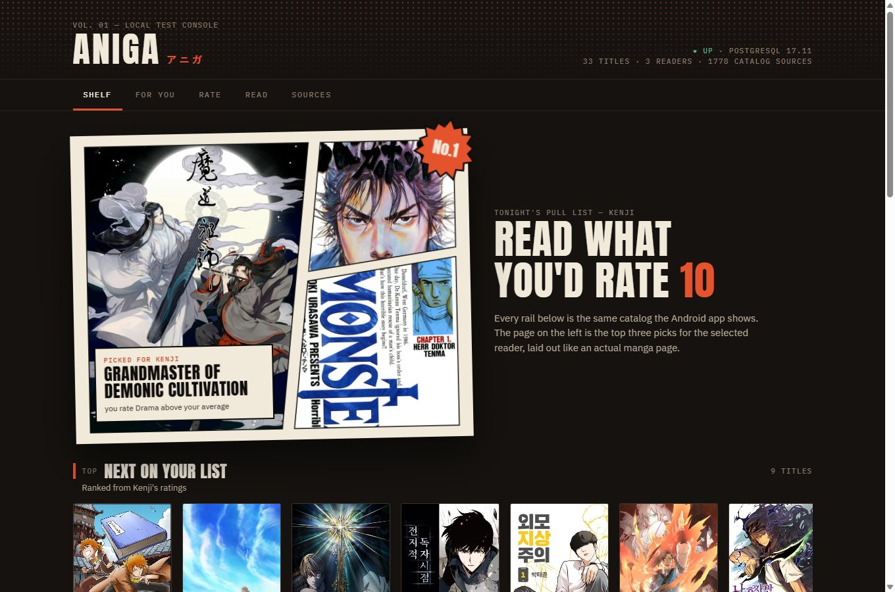
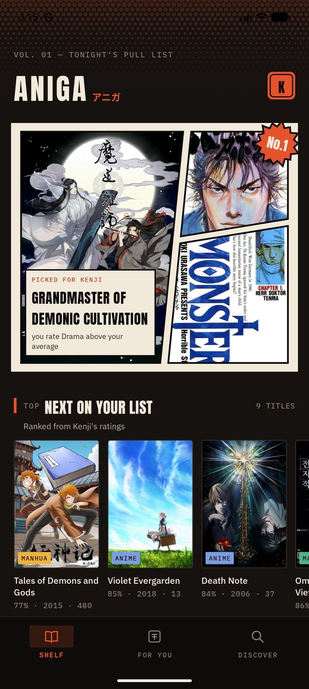
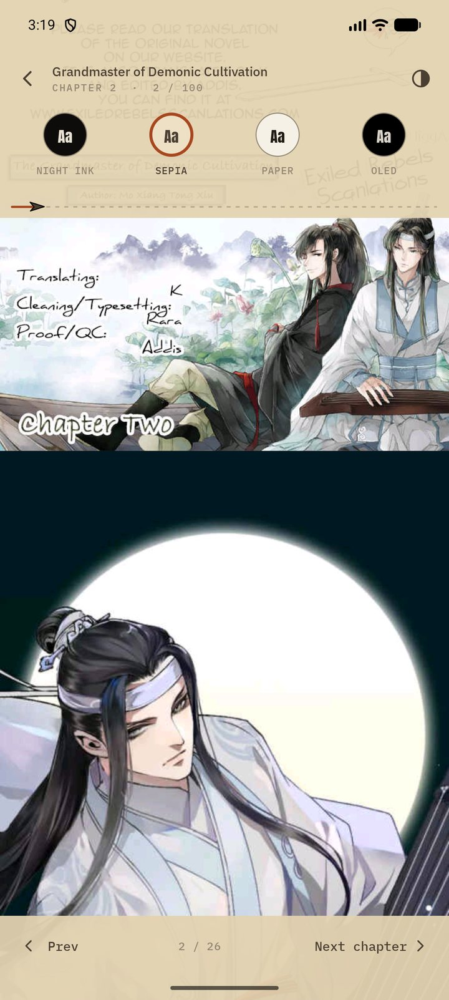
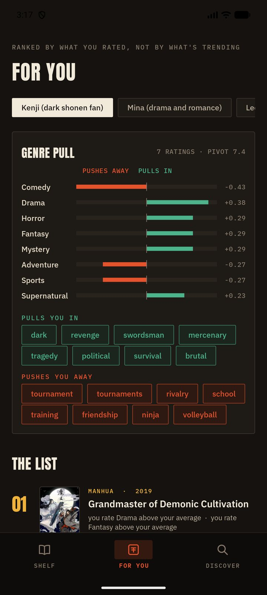
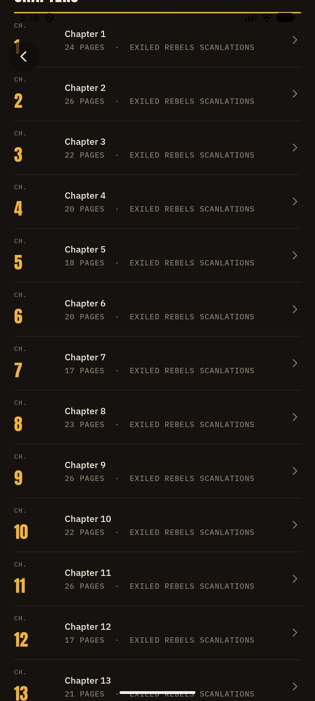
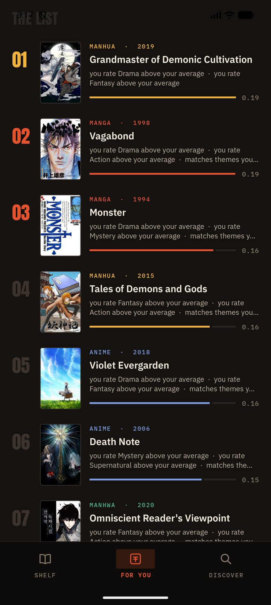
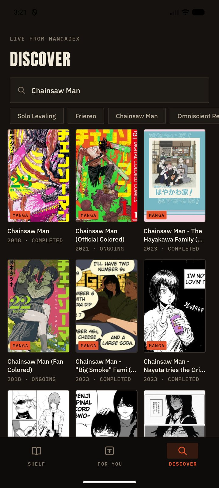
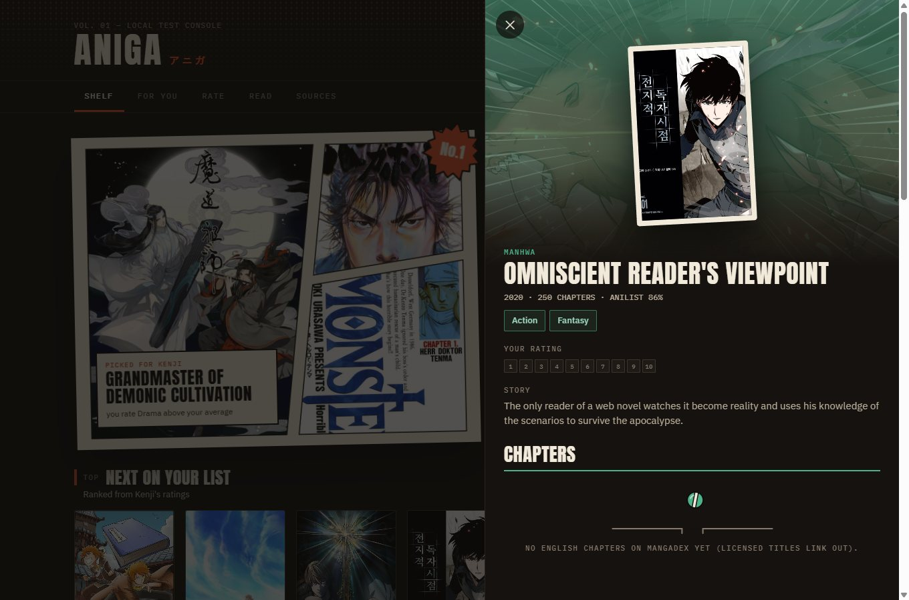
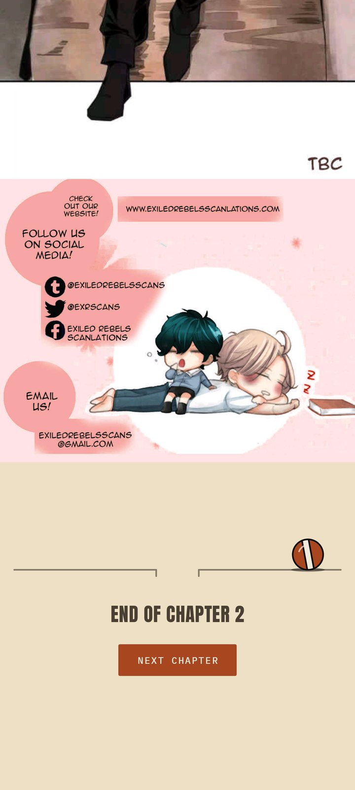
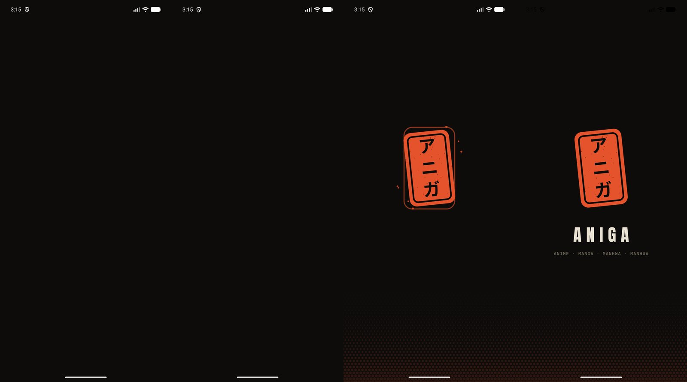

<p align="center">
  
</p>

<h1 align="center">Aniga</h1>

<p align="center">
  <strong>Tonight's pull list, printed in ink.</strong><br>
  A shelf for anime, manga, manhwa, and manhua that learns what you would actually finish.
</p>

<p align="center">
  
  
  
  
  
</p>

<p align="center">
  Open it and the first thing you see is a page, not a feed.<br>
  Three covers, laid out like a printed spread, with a reason under the one it thinks you will love.
</p>

<br>

<h3 align="center">The same shelf, in your hand</h3>

<table>
  <tr>
    <td align="center" width="33%" valign="bottom">
      <br><br>
      <strong>Shelf</strong><br>
      <sub>Three picks, then the rest of the list.</sub>
    </td>
    <td align="center" width="33%" valign="bottom">
      <br><br>
      <strong>Reader</strong><br>
      <sub>Night, sepia, paper, or true black.</sub>
    </td>
    <td align="center" width="33%" valign="bottom">
      <br><br>
      <strong>For You</strong><br>
      <sub>Continue, then a reason for every row.</sub>
    </td>
  </tr>
</table>

<br>

## What you can do with it

<table>
  <tr>
    <td width="50%" valign="top">
      <br>
      <strong>Open a real chapter</strong><br>
      <sub>Read from the start, jump to the latest, or type a number. Leaving the page saves your place.</sub>
    </td>
    <td width="50%" valign="top">
      <br>
      <strong>Pick up where you stopped</strong><br>
      <sub>For You leads with the titles you are in the middle of. Library says when a new chapter is out.</sub>
    </td>
  </tr>
  <tr>
    <td width="50%" valign="top">
      <br>
      <strong>Find it from a title, a sentence, or a frame</strong><br>
      <sub>A screenshot of a scene comes back as the episode. A cover search is for art we have indexed.</sub>
    </td>
    <td width="50%" valign="top">
      <br>
      <strong>Hand your taste to a friend</strong><br>
      <sub>Share one title into a chat, or send a link to your report: every score, and the genres that pull you in.</sub>
    </td>
  </tr>
</table>

<br>

## The page remembers the paper

<p align="center">
  
  &nbsp;&nbsp;
  
</p>

<p align="center">
  Scroll, and the chrome gets out of the way.<br>
  Reach the end, and the shelf remembers where you stopped.
</p>

<p align="center">
  
</p>

<p align="center">
  <a href="learning/README.md"><strong>Walk through every screen →</strong></a>
</p>

<br>

## Open it

The console runs on your machine.

```powershell
cd infra
copy .env.example .env
docker compose up -d --build
```

Then open [http://localhost:8080](http://localhost:8080).

The phone build reads its address from `aniga.local.properties` (there is an example beside it). With nothing set, it looks for the console on the emulator.
