# 08 — Design system: "Sumi & Hanko"

**Problem (session 3 feedback):** the first console and the plan looked like generic "AI slop": teal-on-dark, rounded cards, text-only rows, no covers, no motion with meaning. The reader colours were poor.

**Fix:** one visual identity shared by the Android app and the web console. It is built on what manga actually *is* — printed ink on paper, panels and gutters, screentone, focus lines, a red seal stamp — instead of a default dark UI kit.

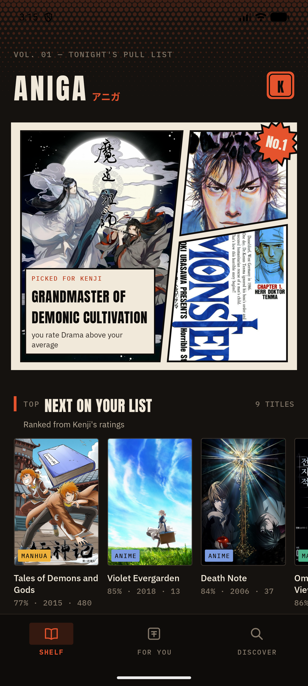

## 1. Research that drove the decisions

| Question | What I found | Decision |
|---|---|---|
| Why do dark UIs look "AI-made"? | Neutral grey/blue-black backgrounds + one saturated accent (teal/purple) + uniform 12–16 px radius cards is the default output of most UI kits. | Warm ink blacks (`#15120F`, a brown-black like sumi ink), cream text instead of white, **2–3 px radii** (print, not app). |
| Pure black or dark grey for reading? | Pure black + pure white text causes halation/smearing for many readers (astigmatism); Material and Apple reading apps use dark grey and off-white. | Default reader tone "Night ink" `#0E0C0A` with text `#E9E1D2`. True black is an explicit opt-in (OLED). |
| What is a good sepia? | Kindle/Apple Books style sepia sits around bg `#F4ECD8`, text `#4A3F33`: warm, ~8:1 contrast, low glare. | Sepia `#EDE0C4` / `#4A3F33`, Paper `#F6F1E7` / `#221C17`. |
| Should the reader chrome stay visible? | Webtoon readers (Naver, Tapas, Mihon) hide chrome while scrolling forward and show it on tap or upward scroll. | Auto-hide on forward scroll, tap to toggle, immersive system bars when hidden. |
| How do real manga pages lay out panels? | Panels are separated by white gutters, often **slanted**, with narration in rectangular caption boxes and shouts in spiky balloons. | The home hero is a literal manga page: 3 clipped panels, slanted gutters, a narration caption, a "No.1" burst balloon. |
| How do pros animate along a path on Android? | `PathMeasure.getPosTan()` returns position **and tangent** at a distance; rotate by `atan2(tan.y, tan.x)`. On the web, SVG `<animateMotion rotate="auto">` does the same. | Paper plane loader on both platforms uses exactly this. |
| What makes motion feel physical? | Disney's principles: squash & stretch, anticipation, follow-through; rotation must match travelled distance or a ball "slides". | Rolling ball: angle = x / r, squash on landing, dust, shadow that shrinks with height. |

## 2. Palette

| Token | Hex | Use |
|---|---|---|
| ink-950 / 900 / 800 / 700 / 600 | `#0E0C0A` `#15120F` `#1E1A16` `#29231E` `#3B332C` | Backgrounds → raised surfaces → hairlines |
| paper-100 / 200 / 300 / 500 | `#F1E9DA` `#E4D9C5` `#B9AD9A` `#85796A` | Primary text → secondary → muted meta |
| **hanko** | `#E5532D` | The single brand accent: seal, selected nav, CTA |
| yamabuki | `#EFB23B` | Gold for numbers/scores only |

**Every media type has its own colour**, used everywhere that type appears (cover tag, rail bar, chapter numbers, rank numbers, match bar):

| Type | Colour | Why |
|---|---|---|
| Anime | indigo `#7C9CE0` | Screen/light, cool — not "printed" |
| Manga | hanko `#E5532D` | Japanese print, the seal |
| Manhwa | jade `#4DB38A` | Distinct from both; reads well on ink |
| Manhua | gold `#EFB23B` | Cultivation/wuxia gold |

Taste colours reuse the same logic: **jade = pulls you in, hanko = pushes you away**.

Detail screens tint themselves with the **cover's dominant colour from AniList** (`coverImage.color`, stored in `media.accent_color`). Raw accents can be muddy or neon, so `Ui.tame()` clamps HSL saturation ≤ 0.72 and lightness to 0.52–0.68 before use.

## 3. Typography

| Role | Font | Why |
|---|---|---|
| Display | **Anton** (OFL), always uppercase | Condensed poster type like manga cover logos; huge contrast with body text |
| UI / body | **IBM Plex Sans** (OFL) | Neutral but with character; good at small sizes |
| Meta / kickers | **IBM Plex Mono** caps, +12% tracking | Looks like issue numbers and printer's marks |
| Kana | system CJK bold | アニガ in the seal and wordmark |

Bug worth remembering: putting `android:fontFamily` on the **theme** silently overrides every `TextAppearance`, so Anton never showed up. Fonts are now only set in text appearances, and Material's own `TextAppearance.Material3.*` parents were dropped because they force a `lineHeight` that made Anton headings double-spaced.

## 4. Signature elements

- **Screentone** (`ScreentoneView`, CSS radial-gradient + mask): hex dot grid whose dot radius grows along a gradient, like printed tone.
- **Speed lines 集中線** (`SpeedLinesView`, SVG polygons): 96 tapered triangles converging on the cover; deterministic seed so they don't reshuffle.
- **Manga page hero** (`PanelImageView`): one image per polygon panel, each centre-cropped to its *own* polygon bounds (biased to the top third where faces are), inked border, touches only accepted inside the polygon so stacked full-size views behave like separate panels.
- **Typographic covers** (`TypographicCover`): titles with no art (e.g. *The Beginning After the End*) get a printed placeholder in their type colour with halftone — never a grey box with an icon.
- **Seal** (`HankoStampView`, launcher icon, favicon): vermilion rounded seal with carved アニガ and worn grain.

## 5. Motion — illustrative, not decorative

No blinking, pulsing or shimmer skeletons. Every animation is a small scene:

| Animation | Where | How it works |
|---|---|---|
| **Hanko stamp** | Splash (app + web) | Falls from 2.6× scale with −16° tilt (ease-in), impact at 42 %, damped press `1 − 0.07·e^(−6u)·cos(10u)`, two ink rings expand and fade, four ink splatters fly off the seal, wordmark rises after impact. |
| **Paper plane** | All loading states | Figure-eight (lemniscate of Gerono) route; `getPosTan` → position + heading; banks harder on the steep parts; contrail of 16 puffs. Web draws the route in hanko ink (`stroke-dashoffset`) before the plane flies it. |
| **Rolling ball** | Empty states, end of chapter | Anticipation crouch before the gutter, ballistic hop, second bounce, squash on landing, dust. Same maths on Android and the web canvas. |
| **Chapter ink** | Detail chapter list | The red rule wipes in; rows rise in a 25 ms cascade and nudge on hover. Source chips stamp when selected and show `N CH`. |
| **Page settle** | Reader | A loaded page fades up 10 px so replacements are visible, not a pop-in. |
| **Speed-line burst** | Detail header | Lines shoot in from the edges (720 ms decelerate) when the cover arrives. |
| **Shared-element cover** | Tile → detail | `makeSceneTransitionAnimation`, enter postponed until Glide delivers the image. |
| **Page placement** | Home hero | Page slides up and un-rotates like it is dropped on a desk, panels ink in one by one, caption slides, burst pops with overshoot. |
| **Plane progress** | Reader | Reading progress drawn as a flight: dashed route, solid flown line, plane pitches up while you scroll forward. |
| **Diverging taste bars** | For You | Bars grow out from the centre axis in a 70–80 ms cascade. |

Timing tokens: 180 ms (exit), 280 ms (UI), 420–520 ms (entrances); easing `cubic-bezier(.2,0,0,1)` (Material "emphasized"). The web console honours `prefers-reduced-motion`.

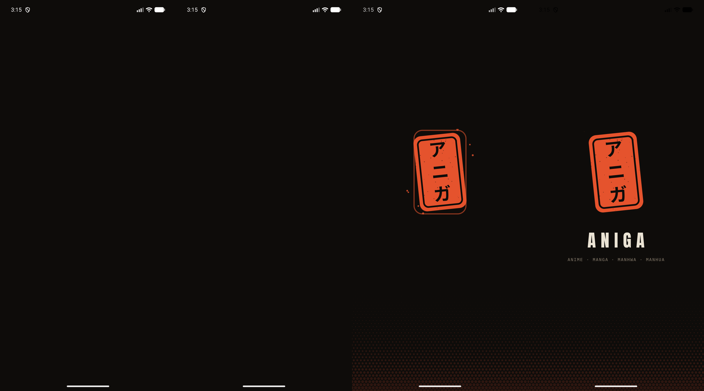

## 6. Reader colour scheme

| Tone | Background | Chrome | Text | Accent | Notes |
|---|---|---|---|---|---|
| Night ink (default) | `#0E0C0A` | `#1A1613` @ 97 % | `#E9E1D2` | `#E5532D` | Warm near-black, no halation |
| Sepia | `#EDE0C4` | `#E2D2B0` | `#4A3F33` | `#A8461F` | Long sessions, low blue light |
| Paper | `#F6F1E7` | `#ECE4D4` | `#221C17` | `#C8401E` | Daylight; cream, not white |
| OLED | `#000000` | `#0C0C0C` | `#D8D2C8` | `#D9542F` | AMOLED battery; opt-in only |

The tone recolours everything at once: page background, chrome, icon tints, the progress plane, the end-of-chapter ball and button, and the **status-bar icon colour** (`setAppearanceLightStatusBars` for Sepia/Paper). Webtoons (manhwa/manhua) render with **zero gap** so the strip is continuous; manga pages get a 6 dp gutter. Page placeholders use a 6 % lift of the background so a loading page is visible but quiet.

| Night ink | Tone picker | Sepia | End of chapter |
|---|---|---|---|
| 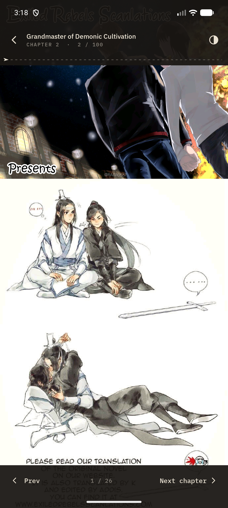 | 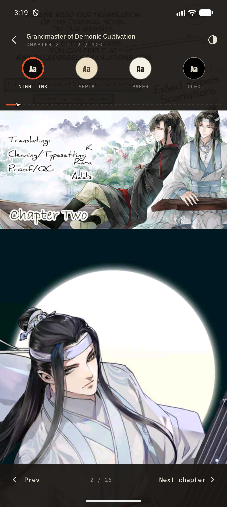 | 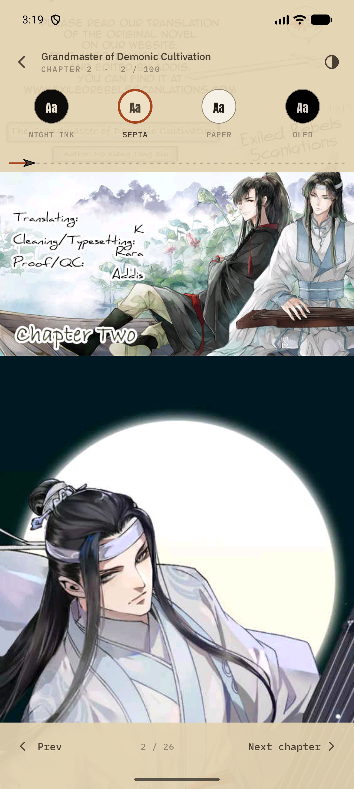 | 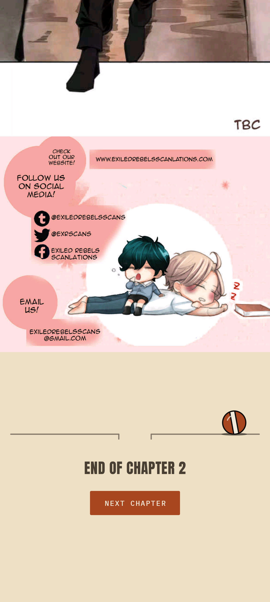 |

## 7. Screens

| For You | Detail | Chapters loading | Discover |
|---|---|---|---|
| 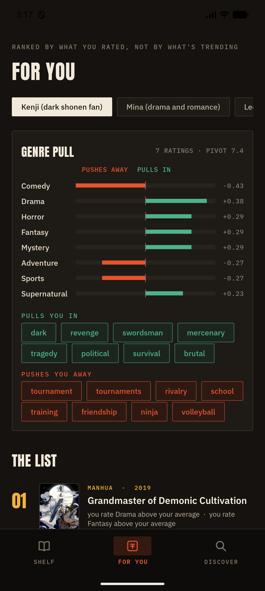 | 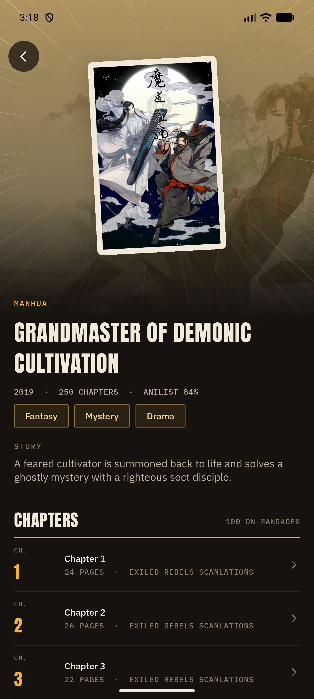 | 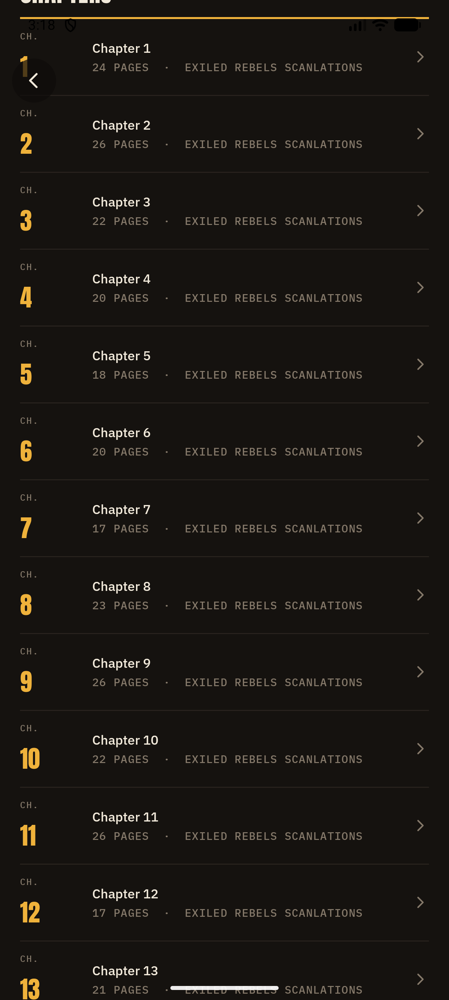 | 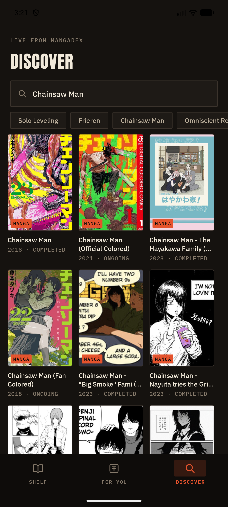 |

Web console, same system:

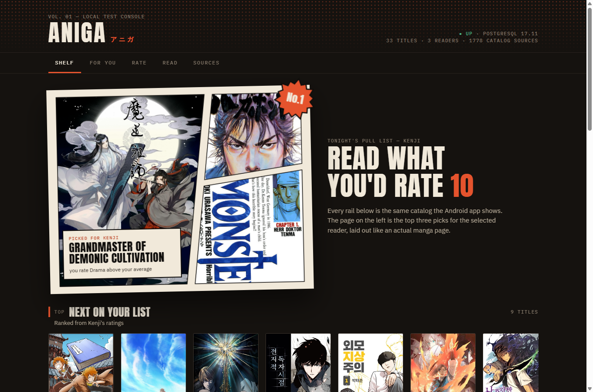
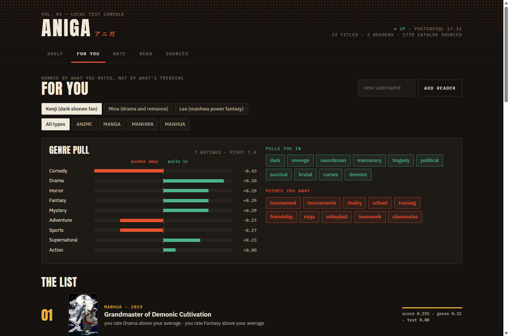
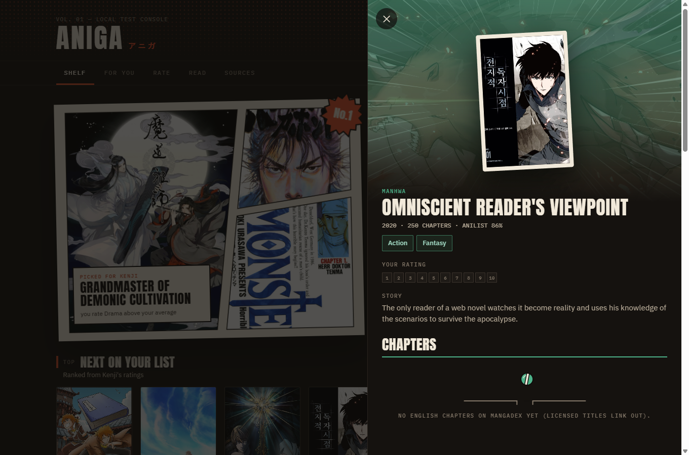
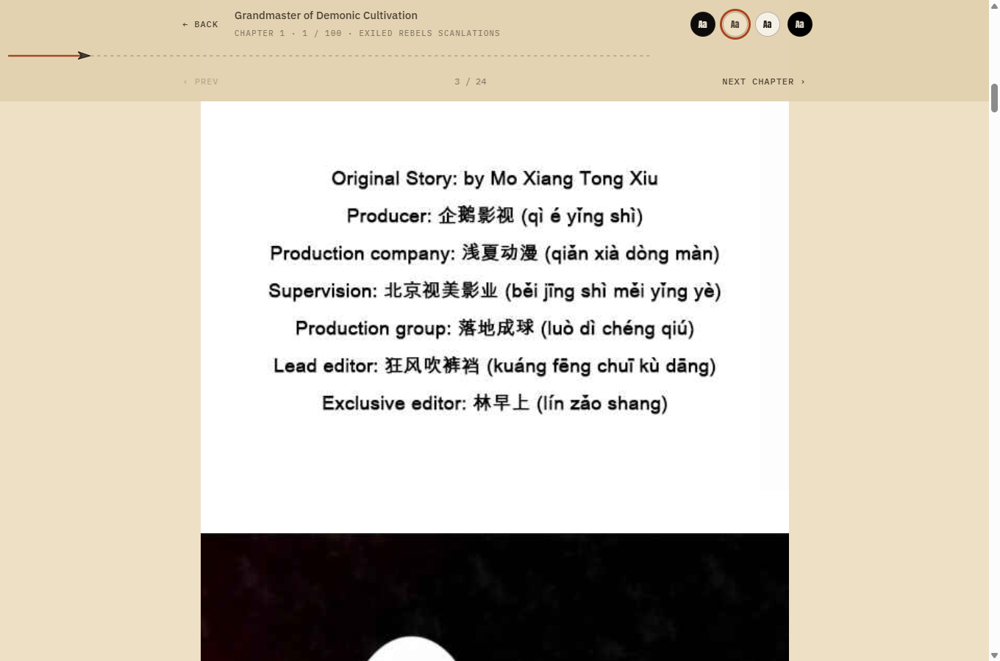

## 8. Anti-slop rules (checklist for new screens)

1. No neutral grey or blue-black; use the ink scale.
2. No pure white text; paper-100 at most.
3. Radii 2–3 px. Pills only for chips that are actually toggles.
4. Every list of titles shows **cover art** (or the typographic cover). Never text-only rows.
5. Every media type uses its type colour; never invent a new accent per screen.
6. Loading = plane, empty/end = ball. No spinners, no shimmer.
7. Display text is Anton uppercase; metadata is mono caps. Don't mix more than these three faces.
8. Motion must depict something (flight, roll, stamp, burst). If it only blinks or pulses, delete it.

## 9. Files

| Android (`app/src/main/java/com/example/aniga/`) | Purpose |
|---|---|
| `ui/widget/PaperPlaneLoaderView` | Loader |
| `ui/widget/RollingBallView` | Empty/end state |
| `ui/widget/HankoStampView` | Splash seal |
| `ui/widget/SpeedLinesView`, `ScreentoneView`, `BurstView` | Manga print elements |
| `ui/widget/PanelImageView` | Polygon-clipped panel images |
| `ui/widget/PlaneProgressView`, `TasteBarView`, `StatusView`, `TypographicCover`, `CoverImageView` | Reader progress, taste chart, state switcher, placeholder cover, 2:3 cover |
| `ui/reader/ReaderTheme` | The four tones |
| `res/values/colors.xml`, `styles.xml`, `themes.xml`, `res/font/` | Tokens |

Web: `backend/src/main/resources/static/console.css` (+ `index.html`, `static/fonts/`), the same tokens as CSS variables.

Backend change to support this: `media` gained `cover_url`, `banner_url`, `accent_color`, `anilist_id`, `average_score`. `tools/media-sync/fetch_anilist_art.py` fetches them from AniList GraphQL and writes `infra/db/init/004_media_art.sql` (32 of 33 titles matched).

## 10. v2 — more Japan, more motion (session 4)

The feedback was that the colours were good but could be better, with more animations and "a little more Japanese stuff". Each new motif has a job; none is wallpaper.

### Traditional colours added (named after the Japanese colour they come from)

| Token | Hex | Used for |
|---|---|---|
| `sakura` 桜 | `#F2A7B8` | Petals, image-search drop zone, webcomic type |
| `ai` 藍 (indigo) | `#3D6A9E` | Seigaiha wave lines in headers |
| `matcha` 抹茶 | `#9BB067` | Reserved for future "new chapter" accents |
| `fuji` 藤 (wisteria) | `#A88BC7` | BLOCKED health |
| `kincha` 金茶 | `#C98A2E` | Reserved for premium/official badges |
| status colours | current = like green, completed = anime blue, planning = paper, paused = yamabuki, dropped = hanko | Status spines, chips and progress |

### New motifs

| Motif | Where | What it means / how it moves |
|---|---|---|
| **Ink-brush bottom nav** (`InkNavView`) | Android main nav; web top nav (`#navInk`) | A sumi brush stroke travels to the new tab: the head eases out, the tail eases in, so it **stretches mid-flight** like a real stroke. The selected tab's kanji gets a hanko seal that drops in from 1.7× and settles with a damped squash `1 − 0.08·e^(−6u)·cos(11u)` and an ink ring; the old seal lifts off. Reselecting wobbles the seal. Haptic tick on tap. |
| **Tab kanji** | 棚 shelf · 推 recommend · 探 search · 帳 ledger (library) · 評 rate · 源 sources | One character per screen. Users learn them as icons. |
| **Sakura** (`SakuraView`, web canvas) | Discover header, web header | 16 petals that fall, sway, spin and **flip** (scaleX by cos), plus a slow gust term. They pause when off-screen to save battery. |
| **Seigaiha 青海波** (`SeigaihaView`, CSS data-URI) | Detail header, Library header | The wave pattern of good fortune. A BitmapShader tile drifts horizontally over 16 s; behind a banner it reads as the sea under the title. |
| **Hanko rating** (`HankoRatingView`, `.hanko-rate`) | Shelf panel, RateSheet | Ten square seals. Drag or tap; on release the chosen seal is **stamped** (scale-down + ink ring). Fill ramps from yamabuki (1) to hanko red (10). |
| **Mode kanji** | Discover: 探 title, 語 story, 絵 image | The big background kanji swaps with an overshoot when the mode changes. |
| Rails rise | Home rails, chapter lists | Staggered slide-up (25–30 ms per row), never more than ~400 ms total. |
| Cover press | Every cover | Scale 0.96 on press, overshoot back on release. |

### Screen changes

- **Bottom navigation:** Shelf · For you · Discover · Library. Fragments slide and fade in the direction of travel.
- **Shelf home:**
  - 続 Continue (CURRENT titles with "EP 5/28" badges);
  - 推 For you ("Because you loved Frieren");
  - then per-type rails (manhwa, manga, manhua, anime), each fetched separately so every type always has 40 titles.
- **Discover:** sakura header and mode toggle; a source chip row (Catalog / MangaDex 61 / Pepper&Carrot / xkcd) with a language picker; result badges show *why* a title matched.
- **Detail:** seigaiha header, facts line, shelf panel, gallery, cast, source chips, episode list, More like this.
- **Library (new):** stats line (titles, episodes watched, chapters read), status filter chips, rows with a coloured status spine, progress bar and score seal.

Rules kept from v1: no spinners, no shimmer, and motion must depict something.
