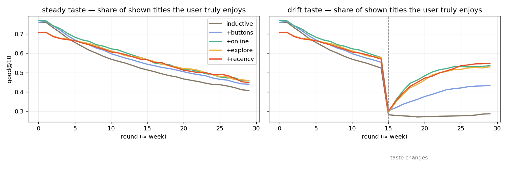

# 15 — Learning from feedback: the recommender adapts to you

**Request (session 6):** the user should see what the model thinks they like and be able to change it. If they liked gore before but now rate a gore title low, the model should move. A recommended title the user did not like should count as a negative and make the next list better.

**Answer in one line:** the trained blend ([12](12-training-report.md)) stays fixed. On top of it sits a small **per-user online model** that takes one gradient step on every reward, plus hand-set boosts and mutes, plus a few **exploration** slots. Every step is logged, so the user can see what moved and why.

## 1. Why a contextual bandit and not "full" RL

| Option | What it needs | Verdict |
|---|---|---|
| Retrain the blend nightly | Many users and events; hours of compute | Too slow: a low rating must change tomorrow's list *now* |
| Deep RL (DQN / policy gradient over sessions) | Millions of logged sessions; a simulator you trust | No real traffic yet; very hard to explain in the UI |
| **Contextual bandit: per-user logistic weights over title features + exploration bonus** | One SGD step per event; a few hundred floats per user | **Chosen.** It updates instantly, every number has a name ("Horror +0.34"), and the simulation can tune it |

This is the reinforcement-learning loop in its simplest honest form: **act** (show a list), **observe a reward** (rate, ♥, ✕, open, finish, drop), **update the policy**, and **explore** where the model is unsure.

## 2. The model (`OnlineLearner.java`)

Features of a title, unit-normalised: every genre `g:Horror` (1.0), its media type `type:MANHWA` (1.0), and up to 8 tags `t:gore` (0.5).

```
predict  p = σ(2·θ·x)                       the model's belief that you will like it, before seeing the reward
update   θ_f += η·(r − p)·x_f   (η = 1.2, clamp ±3)
         n_f += x_f                         evidence: how much feedback touched feature f
serve    score = blend + 0.9·θ·x + prefs + β·Σ x_f/√(1+n_f)  (β = 0.8, only for the exploration slots)
```

The `(r − p)` term is why the gore example works. If you rated gore 10 before, `p` for the next gore title is high (≈0.8). Rating it 3/10 (`r` = 0.22) gives a large negative error, so `g:Horror` and `t:gore` drop at once. Romance is untouched because it is not in that title's `x`.

A confirmed expectation teaches little: the error is small, so the weights barely move. `OnlineLearnerTest.expectedOutcomesTeachLittle` checks this.

### Rewards

| Event | Reward r | Where |
|---|---|---|
| Rating 1–10 | (score − 1) / 9 | `FeedbackEvent.fromScore` |
| ♥ More like this | 1.0 | `POST /feedback LIKE` |
| ✕ Not for me | 0.0, and the title is hidden from future lists | `POST /feedback NOT_INTERESTED` |
| Opened a title we recommended | 0.7, only if it was in a logged impression | `POST /feedback CLICK` + `rec_impression` |
| Finished it (no score given) | 0.75 | `LibraryController` |
| Dropped it (no score given) | 0.1 + 0.25 × completion (dropping at episode 1 is worse than near the end) | `LibraryController` |

A click on something we never recommended is not a reward: it says nothing about our list. The e2e test checks this.

### What the user controls (`FeedbackController`)

| Endpoint | Effect |
|---|---|
| `GET /api/users/{id}/taste/v2` | Per feature: `history` (from ratings), `online` (learned), `pref` (hand-set), `effective` = history + online + pref/2, `evidence`. Also the last 12 changes, each with cause, reward, the model's prior `expected`, and the per-feature deltas |
| `PUT /prefs {feature, weight}` | 1 = boost (+0.3σ of the blend: climbs, does not take over), −1 = mute (−4σ: gone), 0 = clear |
| `DELETE /taste/online` | Forget all online learning; back to ratings only |
| `GET /recommendations?track=true` | Logs the shown list, so later clicks can be rewarded. Each item has `slot` = EXPLOIT or EXPLORE |

## 3. Exploration

With fewer than 30 rewards, 2 of the slots (1 after that) go to the title with the highest **optimistic** score: blend + online + β × uncertainty. The reason shown names what is being tested: *"exploring — we know little about how you feel about Psychological; tell us if it lands"* (`RecommenderV2.leastKnown`). The UI marks these rows with an **Exploring** tag, so a miss is expected rather than annoying.

## 4. Simulation: does it actually help? (`ml/eval/simulate_feedback.py`)

- 1,500 simulated users with hidden tastes from the 500k dataset generator.
- 30 rounds (≈ weeks).
- Each round: the system shows 10 titles. The user opens, likes, dismisses or rates according to their hidden taste, and the system updates.
- In the **drift** scenario, every user's taste changes at round 15 (the "I'm over gore" case).
- Metric: **good@10**, the share of shown titles the user truly enjoys.



| Variant (each adds to the previous) | Steady: mean good@10 | Drift: last 5 rounds | Drift: cumulative reward |
|---|---|---|---|
| inductive only (trained model, rated titles excluded) | 0.544 | 0.281 | 33.0 |
| + ♥/✕ buttons as signals | 0.570 | 0.428 | 38.3 |
| **+ online weights** | **0.587** | 0.532 | **43.1** |
| + exploration (β = 1.6 at the time) | 0.576 | 0.524 | 42.0 |
| + recency half-life 120 days | 0.573 | **0.543** | 42.3 |

How to read it:

- The curves fall over time because each user gradually consumes the titles they like in a 902-title catalog. The gap between the lines is what matters.
- With online learning, the steady case is **+8%** good@10 and the drift case is **+31%** cumulative reward over the inductive model.
- After the taste change, the inductive model never recovers (0.28). With online learning it climbs back to 0.53–0.54 within about 10 rounds.

Sweeps chose the constants:

| Constant | Values tried | Kept | Why |
|---|---|---|---|
| η (learning rate) | 0.4 / **1.2** / 2.5 | 1.2 | Best cumulative reward; 2.5 over-reacts to one rating |
| online weight | 0.4 / **0.9** / 1.6 | 0.9 | 1.6 recovers 1 round faster but is noisier |
| half-life (days) | 30 / 60 / **120** / 365 | 120 | Flat between 60 and 120; 365 never recovers |
| β (exploration) | 0 / **0.8** / 1.6 / 3 | 0.8 | 0 is best here only because simulated users have no tastes outside the known features, which is exactly where exploration pays in real life. So keep it, but small |

## 5. Tests

- `backend/src/test/.../OnlineLearnerTest.java` (6 tests):
  - unit-length features;
  - p = 0.5 with no history;
  - a like raises and a later low score lowers only that title's features;
  - expected outcomes move weights less than surprises;
  - the clamp holds;
  - uncertainty shrinks with evidence.
- `RecommenderV2HelpersTest.java` (6 tests): labels, franchise keys, diversify order, the `leastKnown` genre-then-tag rule, how ratings and button presses combine, and recency decay.
- `tools/e2e_feedback.js` (18 checks against the running API):
  - horror weight 0 → 0.34 after high ratings, then 0.34 → 0.09 after one low one;
  - every change is logged with `expected`;
  - explore slots are present;
  - NOT_INTERESTED is learned and hides the title;
  - only recommended clicks count;
  - boost takes Romance from 2 to 11 of 20, not 20 of 20;
  - mute takes Horror to 0;
  - prefs are listed first; bad keys are rejected; reset clears; median 28 ms warm.

## 6. In the apps

| | Web console (For you tab) | Android (For you tab) |
|---|---|---|
| Reward buttons | ♥ / ✕ on every row, toast with Undo, CLICK on open | "♥ More like this" / "✕ Not for me" on every row; ✕ slides the row out with a Snackbar Undo (sends CLEAR); opening a pick sends CLICK |
| Exploration | "Exploring" badge | "Exploring" tag next to the type |
| What the model thinks | Diverging bars per feature; tap to boost / mute / clear | Same: bars are keyed by feature, so after a reaction they **glide** to the new value. A white tick marks where the bar would be from ratings alone. Tap cycles boost ▲ → mute ✕ → clear |
| Why it changed | "Lately it learned" list | Same: "Rated X 3/10 · expected 82%, got 22%", then the features that moved, green up and red down |
| Reset | Button | "Forget reactions" |
