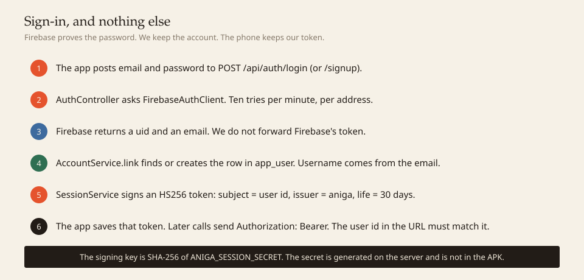

# The live stack

The phone, the server, and the lock on the door. This is what was built so Aniga can run on the EC2 box, how a request moves through Spring Boot, and how to install the app.

<p align="center">
  
</p>

The database is Postgres, on the same machine as the API, inside Docker. It already held users, shelves, ratings, chat, and the recommender. Firestore would have been a second shape for the same rows. RDS would have been a second bill.

Firebase does one job: it checks an email and a password. The backend calls it. The phone does not.

---

## What we did, in order

| Step | What | Why |
|---|---|---|
| 1 | Postgres stays on the EC2 box. It is not given a public port. | The data never has its own door onto the internet. |
| 2 | Caddy listens on 80 and 443 and forwards to the API. | One public door. The API itself is only on the Docker network. |
| 3 | A private certificate authority, shipped inside the app. | The phone can use HTTPS without a public certificate for an `amazonaws.com` name. |
| 4 | `POST /api/auth/signup` and `/login`. The backend asks Firebase, then returns our own token. | The phone never holds a Firebase credential. |
| 5 | `AuthFilter` on library, ratings, recommendations, friends, chat, and reports. | The user id is taken from the token, not trusted from the URL. |
| 6 | Friends, a global room, group rooms, a shared shelf, a reading type, and taste matches. | The social features sit on tables we already had. |
| 7 | The Android app points at the EC2 address, sends the session, and opens a Circle tab. | The phone is a client of our API only. |
| 8 | An APK built against that address, served from the box. | You can install it without a laptop. |

Secrets (database password, session signing key, admin token) were generated on the server into `infra/.env`, mode `600`. They are not in git. The SSH private key stays in Downloads. It is not in the repo.

---

## Spring Boot, as this project uses it

Spring Boot is a Java program that brings its own web server. There is no separate Tomcat to install. On startup it reads `application.yml`, builds the objects we declared, and listens on port 8080. Docker is what publishes that process. Spring does not know it is on EC2.

<p align="center">
  
</p>

The pieces, with the names they have in this repo:

| Piece | What it is here | The idea |
|---|---|---|
| `application.yml` | Port, database URL, Firebase key, session secret, admin token | Configuration. Real values come from the environment. The file in git has empty defaults. |
| `@RestController` | `AuthController`, `PeopleController`, `ChatController` | A class whose methods are URLs. Spring turns the JSON into a Java record and back. |
| `OncePerRequestFilter` | `AuthFilter` | Runs before the controller, once per call. This is the lock. |
| `@Service` | `AccountService`, `PeopleService`, `ChatService`, `SessionService` | The rules. Controllers stay thin. |
| `JdbcClient` | The SQL in those services | Hand-written queries. No JPA. You can read the statement next to the rule it enforces. |
| `RestClient` | `FirebaseAuthClient` | An HTTP client. This is the only place that dials Firebase. |
| Records | `Credentials`, `AuthResponse`, `Match`, `Personality` | Small immutable holders for one request or one response. |
| Constructor injection | `new` is not used for these | Spring builds one of each and passes them in. A test can pass a fake. |
| Problem detail | `application/problem+json` | Errors are a status plus a `detail` sentence. The sign-in screen shows that sentence. |

A controller method does not choose who you are. `AuthFilter` reads the bearer token, checks the signature and the expiry, and stores the user id on the request. `PeopleController` asks the filter for that id. If the path says `/api/users/2/...` and the token belongs to user 1, the filter answers 403 before the controller runs.

Admin actions are a second lock. Creating a user, reloading the model, and starting a source health run need the header `X-Admin-Token` to match `ANIGA_ADMIN_TOKEN`. Catalog search and chapter reading stay open, so a reader can look around. `/api/health` stays open and does not list accounts.

Virtual threads are turned on in `application.yml`. A chat poll or a slow source call does not need its own platform thread. The heap is capped at 256 MB. The box is a `t3.micro`: 908 MB of RAM and an 8 GB disk. How that disk filled, and why the swap file is 512 MB, is [20-disk-and-memory.md](20-disk-and-memory.md).

---

## Sign-in

<p align="center">
  
</p>

The token is HS256. The key is the SHA-256 digest of `ANIGA_SESSION_SECRET`, so a short secret still becomes a 256-bit key. The claims are the user id, the issuer `aniga`, and an expiry 30 days out. Passwords are not logged. Login and sign-up share a small limiter: 10 attempts a minute for one client address.

Until Email/Password is switched on in the Firebase console, the backend still accepts sign-up. It stores a PBKDF2 hash in Postgres and returns the same session token. When that switch is turned on later, new accounts are checked with Firebase, and accounts created during the gap keep signing in against the hash. The API key alone cannot flip the switch.

---

## Friends, a reading type, and a match

<p align="center">
  
</p>

Migration `011_people.sql` adds the friend request table and a single global chat room. Accepting a request writes the existing direct room. A group room is the existing group type: a title and a list of usernames.

The reading type counts genres on titles you scored 6 or higher.

| Type | Genres that feed it |
|---|---|
| The Explorer | Action, Adventure, Fantasy, Sci-Fi, Mecha |
| The Romantic | Romance, Slice of Life, Music, Drama |
| The Strategist | Mystery, Psychological, Thriller, Supernatural, Horror |
| The Jester | Comedy, Sports, Ecchi, Harem |

The strongest share becomes the name. With no ratings yet, the type is The Newcomer.

A match is someone else who scored the same titles 7 or higher. Affinity is the number of those shared titles, plus half a point for each genre those titles have in common. The card names one shared title ("You both rated Attack on Titan highly") and lists a few of their 8-and-above picks that you have not rated. Your own recommendations are `GET /api/me/recommendations`, so the client cannot ask for someone else's list. A friend's shelf is `GET /api/people/{id}/shelf`, and only after they have accepted.

The Circle tab on the phone shows the type, incoming requests, friends, matches, and the global room. The room screen polls for messages. Sending from the app landed in the same room the API already had.

---

## The APK

Install it from the phone's browser:

**https://ec2-32-236-45-71.ap-southeast-2.compute.amazonaws.com/download/aniga.apk**

The browser will warn that the certificate is not from a public authority. That is our own CA, on purpose. Choose to proceed, then download. The app, once installed, already trusts that same CA for this host, so the shelf and Circle do not show the warning.

The same file is also on port 80, which needs no warning. This box's security group does not accept port 80 from the internet yet. Opening 80 (and leaving 5432 closed) makes `http://ec2-32-236-45-71.ap-southeast-2.compute.amazonaws.com/download/aniga.apk` work directly.

The build that produced it set the API address at compile time (`BuildConfig.API_BASE_URL`). A debug build is signed with the debug key, which is enough to install on your own phone. Android will ask you to allow installs from the browser.

After it is on, create an account only once Email/Password is enabled. Until then the sign-in screen will say so, in the sentence the API returns.

---

## How to check it

From any machine:

```text
curl -sk https://ec2-32-236-45-71.ap-southeast-2.compute.amazonaws.com/api/health
curl -sk -o /dev/null -w "%{http_code}\n" https://ec2-32-236-45-71.ap-southeast-2.compute.amazonaws.com/api/me
```

Health should be 200. `/api/me` with no token should be 401.

On the phone: open the APK link, install, and sign in after the Firebase switch. Circle should show a reading type once you have rated a few titles. The global room should send.
