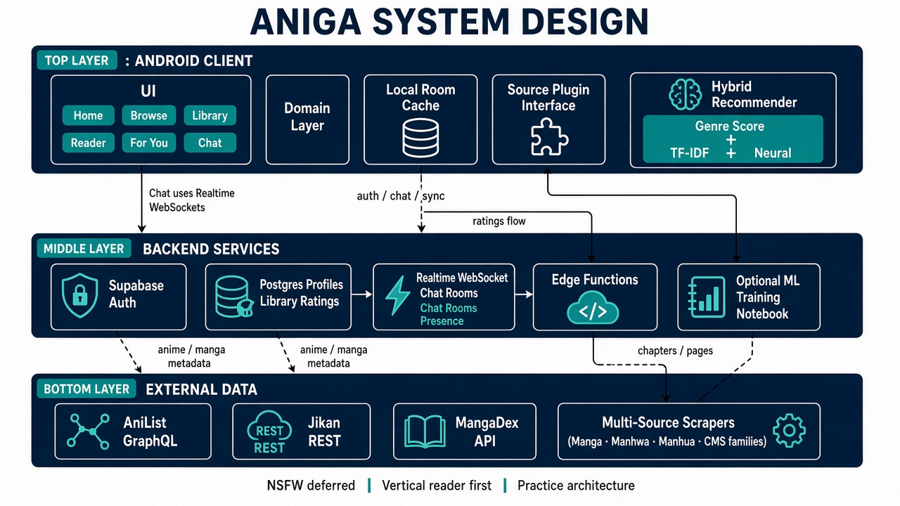

# Aniga — learning notes

This folder explains **what** was built, **how**, and **why**, so every decision can be defended in an interview.
Read in order; each file stands alone.

| File | What it covers |
|------|----------------|
| [01-worklog.md](01-worklog.md) | Chronological log of what was done in each session |
| [02-architecture-decisions.md](02-architecture-decisions.md) | Decision records: options considered, choice, trade-offs |
| [03-database.md](03-database.md) | Local Postgres in Docker, schema design, why each table exists |
| [04-backend-and-web-console.md](04-backend-and-web-console.md) | Spring Boot API, endpoints, the browser test console |
| [05-sources-and-scraping.md](05-sources-and-scraping.md) | Source catalog from the extension indexes, adapter pattern, MangaDex, legal boundary |
| [06-recommender-v1.md](06-recommender-v1.md) | The shipped genre + TF-IDF recommender, the maths, the "Naruto 5 vs AoT 10" example |
| [07-synthetic-data.md](07-synthetic-data.md) | The simulator that generates bogus-but-structured users and events |
| [08-design-system.md](08-design-system.md) | "Sumi & Hanko" visual identity: palette, per-type colours, fonts, illustrative animations, reader tones |
| [09-sources-v2.md](09-sources-v2.md) | Adapters for every readable extension (MangaDex ×61 languages, Pepper&Carrot, xkcd), health check of all 1,778, MangaDex bugs fixed |
| [10-catalog-anime-library.md](10-catalog-anime-library.md) | 902 real AniList titles, anime metadata (episodes, gallery, cast), shelf status/progress/rating rules |
| [11-dataset-500k.md](11-dataset-500k.md) | The 500,000-user simulator: hidden personas, completion/drop/score model, statistics |
| [12-training-report.md](12-training-report.md) | Popularity vs content vs EASE vs two-tower vs blend, cold start, serving, franchise rerank |
| [13-search.md](13-search.md) | Story search (BM25 + synonyms) and reverse image search (trace.moe + perceptual hash) |
| [14-knowledge-base-and-roadmap.md](14-knowledge-base-and-roadmap.md) | **Start here:** what exists, where it lives, what is next (chat, auth, embeddings) and how |
| [15-feedback-learning.md](15-feedback-learning.md) | The recommender adapts: per-user online SGD on rewards (rate, ♥, ✕, open, finish, drop), boost/mute, exploration, simulation results, what the user sees |
| [16-performance-and-motion.md](16-performance-and-motion.md) | Source caching (single-flight, stale-while-revalidate, rate limiter), find 18 s → 3.8 s, robust cover search, windowed lists, progress on covers, motion research |
| [research/recommender-research-proposal.md](research/recommender-research-proposal.md) | LSTM + feature MLP + RL trend re-ranker research plan |
| [interview-defense.md](interview-defense.md) | Likely interview questions with short answers |



## Run everything locally

Prerequisites: Docker Desktop running, Python 3.10+ (only for the tools/ML scripts). Java is **not** needed on the host; the backend compiles inside Docker.

```powershell
cd infra
docker compose up -d --build        # postgres :5433, adminer :8081, backend :8080
```

| URL | What |
|-----|------|
| http://localhost:8080 | Aniga console: Shelf (continue, for you, per-type rails), For You, Rate, Discover (sources × languages, story search, image search), Library, Sources (health), detail drawer, vertical reader |
| http://localhost:8080/api/health | API health + row counts |
| http://localhost:8081 | Adminer (DB web UI). System: PostgreSQL, server `postgres`, user `aniga`, password `aniga_dev`, db `aniga` |

Reset the database (init scripts only run on an empty volume):

```powershell
docker compose down -v; docker compose up -d --build
```

Regenerate data:

```powershell
python tools/source-ingest/ingest_sources.py        # rebuilds infra/db/init/003_source_catalog.sql
python ml/synthetic/generate_dataset.py             # writes ml/data/*.csv (git-ignored)
```

Android emulator → backend: use `http://10.0.2.2:8080` (the emulator's alias for the host machine).

Build and install the Android app (JDK on `JAVA_HOME`, emulator running):

```powershell
.\gradlew.bat :app:installDebug
```

Refresh cover art from AniList (rewrites `infra/db/init/004_media_art.sql`, then reset the DB volume):

```powershell
python tools/media-sync/fetch_anilist_art.py
```

Catalog, dataset, model, checks (see [14](14-knowledge-base-and-roadmap.md)):

```powershell
python tools/media-sync/fetch_anilist_catalog.py            # 006_catalog.sql (~900 titles, ~15 min, rate-limited)
python ml/data/export_catalog.py                            # ml/data/catalog.csv from Postgres
python ml/synthetic/generate_users_500k.py --users 500000   # ml/data/v2/*.parquet (~50 s)
python ml/train/train_recommenders.py                       # metrics.json + 007_model_v2.sql (~5 min on GPU)
python tools/source-ingest/smoke_all_extensions.py          # every readable extension end to end
node tools/check_console.js                                 # web console: ids exist, script parses
node tools/e2e_feedback.js                                  # feedback loop against the running API (18 checks)
node tools/bench_read.js                                    # source latencies (cold / warm / find)
python ml/eval/simulate_feedback.py                         # feedback-loop simulation → feedback_sim.json + chart
```

Backend unit tests (no host Java needed):

```powershell
docker run --rm -v "${PWD}\backend:/src" -v aniga-m2:/root/.m2 -w /src maven:3.9-eclipse-temurin-21 mvn -q -B test
```
