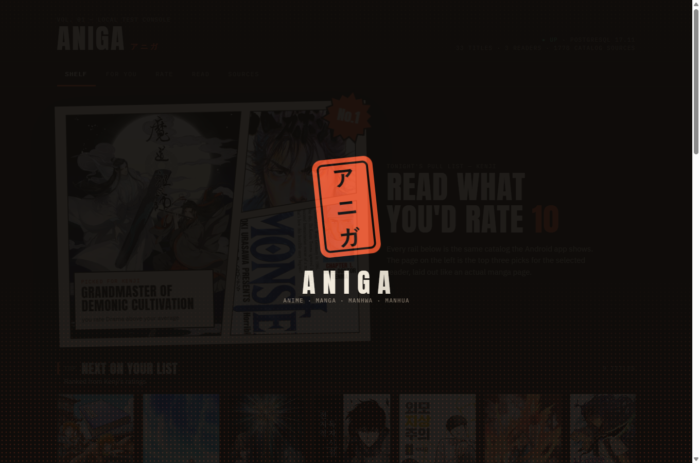
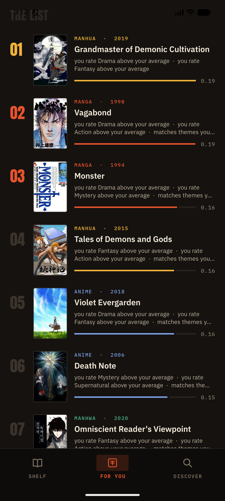
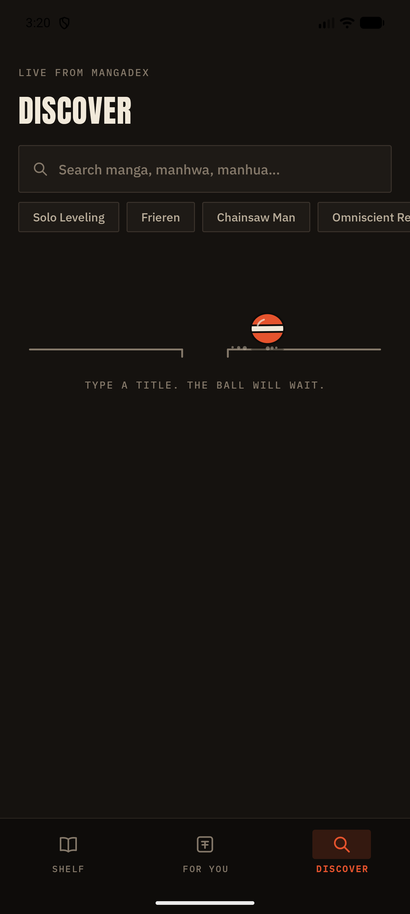

  

<h1 align="center">A walk through Aniga</h1>

  Ink, paper, and a shelf that knows your taste. 
  The same rooms, on a phone and in a browser.

---

## It begins with a stamp

  

  A vermilion seal, the kind pressed into the last page of a book. 
  It lands, the ink flies, and the name comes up after.

---

## The shelf is a page

  

  <em>Vol. 01 — Tonight's pull list.</em> 
  The hero is a real page: panels, a caption, a burst that says No. 1. 
  Under it, the next titles you would reach for, ranked from what you already loved.

  

  On a wider screen the page sits beside the invitation: read what you would rate a ten.

---

## Your taste, said out loud

  

  Ranked by what you rated, not by what is trending. 
  Green reaches toward you. Red leans away. The words under the cover are the reason, not a score you have to decode.

  

  

  Kenji likes the dark stuff. Mina likes drama. Each reader keeps their own list.

---

## Go find something

  

  Type a title. The ball will wait.

  

  Then the covers arrive, live, one edition after another.

---

## Stay with a story

  

  The page takes its color from the art. Story first. Chapters underneath, ready.

  

  

  Rate it from one to ten. The shelf listens, and the next list moves.

---

## Read

  
  &nbsp;&nbsp;
  

  Four lights for the page: night ink, sepia, paper, and true black. 
  Pick one. The chapter stays.

  

  

  A small plane flies along the top as you move down the page. 
  At the end of the chapter, a ball rolls to a stop, and the next one is waiting.

  

---

## The notes

Start with [the one module](19-the-one-module.md) if you want the whole build in a single sitting: what it does, how a tap becomes a chapter, and what we looked at and left alone.

The screens above are the pitch. The pages below are the making of them, for anyone who wants the longer story.

| | |
|---|---|
| [What happened, in order](01-worklog.md) | A diary of the build |
| [The choices](02-architecture-decisions.md) | What was picked, and what was left behind |
| [The shelf's memory](03-database.md) | Where titles, ratings, and progress live |
| [The console](04-backend-and-web-console.md) | The browser beside the phone |
| [Where chapters come from](05-sources-and-scraping.md) | The catalogs behind Discover |
| [The first recommendations](06-recommender-v1.md) | Why one title outranks another |
| [Imaginary readers](07-synthetic-data.md) | A crowd, invented, so the shelf could be tried |
| [Ink and paper](08-design-system.md) | The look: seal, type, and motion |
| [More places to read](09-sources-v2.md) | Languages, editions, and which sources are awake |
| [A real catalog](10-catalog-anime-library.md) | Titles, art, and the rules of the shelf |
| [Half a million readers](11-dataset-500k.md) | A larger crowd, still invented |
| [What the models learned](12-training-report.md) | Which way of recommending won |
| [Search by story or by picture](13-search.md) | Finding a title you cannot name |
| [Where things stand](14-knowledge-base-and-roadmap.md) | The map, and what is still ahead |
| [It keeps learning](15-feedback-learning.md) | Hearts, skips, and a list that moves |
| [Speed and motion](16-performance-and-motion.md) | A faster find, and movement with a reason |
| [Questions worth asking](interview-defense.md) | Short answers, if someone presses |
| [A research sketch](research/recommender-research-proposal.md) | An idea for a later model |
| [The live stack](17-the-live-stack.md) | The machine the shelf is actually running on |
| [Adding a reading source](18-adding-a-source.md) | The file, the records, and the one class that registers itself |
| [The whole thing, once](19-the-one-module.md) | One sitting: what we built, how, and what we decided not to |
| [The disk and the memory](20-disk-and-memory.md) | Why an 8 GB disk filled, and what the 1 GB of RAM is doing |
